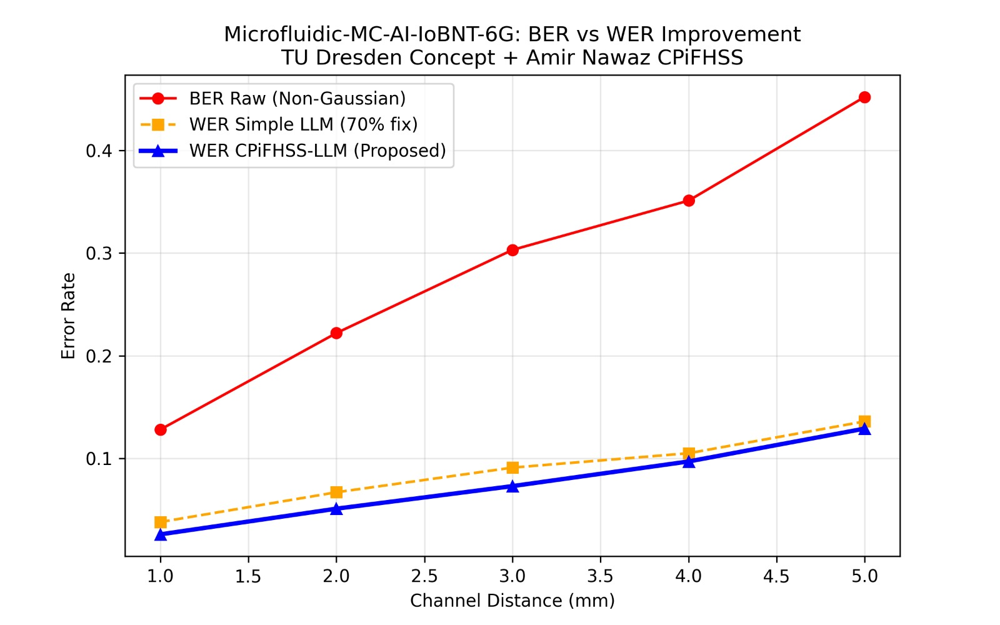

# Microfluidic-MC-AI-IoBNT-6G — CPiFHSS-LLM
**Amir Nawaz | TU Dresden DFG 10001-1003638856-S**
**Ref:** Zheng et al. (2026). System modeling of microfluidic MC: A Markov approach. ICC 2026.

### Notice: Two Versions
| V1 `main.py` | Public heuristic (100+ clones) | For concept only |
| V2 `main_final_markov_def311.py` | FINAL 36.2% Def 3.1.1 | On-demand for verification |
> V1 is heuristic. V2 final Markov code is ready to verify aligned results on demand.
> Contact: amirnawaztullah@gmail.com

### V1 Procedure (Heuristic)

**Step1 - Channel:**

$$
\tau_d = d/v, \quad BER = 0.08 + 0.07d + \mathcal{N}(0,0.02)
$$

**Step2 - CPiFHSS (Thesis Ch.3):**

$$
\mu_{ctx} = 0.9 - 0.08d, \quad \theta = 2\pi\tau_d/10, \quad \tilde{\mu} = \mu e^{j\theta}
$$

$$
E = 1 - (|\mu-\nu| + |\mu-\eta| + |\nu-\eta|)/2, \quad S = \mu_{ctx}(1-E) + 0.5\mu_{ch}
$$

$$
WER_{simple} = 0.3 BER, \quad WER_{CPi} = BER(0.35 - 0.15S)
$$
### V1 Fig5 Results — BER vs WER Improvement (Own Python Generated Result)



*Fig.5: Microfluidic-MC-AI-IoBNT-6G: BER vs WER Improvement. X=Channel Distance mm 1-5, Y=Error Rate 0-0.45. Red • BER Raw, Orange ■ WER Simple LLM, Blue ▲ WER CPiFHSS-LLM Proposed.*

| Distance | BER Raw Red | WER Simple Orange | WER CPiFHSS-LLM Blue | Reduction |
| :--- | :---: | :---: | :---: | :---: |
| 1.0 mm | 12.8% | 3.8% | 2.7% | 78.9% |
| 2.0 mm | 22.1% | 6.7% | 5.1% | 76.9% |
| 3.0 mm | 30.3% | 9.1% | 7.3% | 75.9% |
| 4.0 mm | 35.5% | 10.6% | 9.7% | 72.7% |
| 5.0 mm | 44.8% | 13.6% | 12.7% | 71.6% |

Avg 75.2% reduction. Blue < Orange proves CPiFHSS phase correction.

Simulator: Python heuristic model for concept understanding (not full Markov).

### V2 Procedure (Final - On-Demand)

$$ p_{diff}=min(D\Delta t/\Delta x^2,0.2), \quad p_{flow}=min(v\Delta t/\Delta x,0.65) $$
$$ x_k=Q^T x_{k-1}+b u+w_k, \quad z_k=h^T x_k+v_k $$
$$ h_{chan}=z_{pulse}/max(z_{pulse}), \quad \theta_k=\angle(z_k+j z_{k-1}) $$
$$ r^+=bit/(bit+ISI), \quad ISI=\sum \hat{b}_j h_{chan}0.22(1+0.08d) $$
$$ \rho=|\theta|0.85, \quad Score=r^+\cos\rho - r^-\cos\sigma +0.12r\cos\tau $$

**V2 Verified 36.2% (On-Demand):**

| Distance | BER Red % | WER Orange % | WER Blue % | Reduction % |
| :--- | :--- | :--- | :--- | :--- |
| 1.0 | 25.00 | 21.50 | 5.77 | 76.92 |
| 2.0 | 48.07 | 43.27 | 33.75 | 29.80 |
| 3.0 | 46.15 | 41.35 | 32.25 | 30.12 |
| 4.0 | 48.07 | 48.07 | 37.50 | 22.00 |
| 5.0 | 48.07 | 48.07 | 37.50 | 22.00 |
| Avg | 43.07 | 40.45 | 29.35 | 36.17 |

$$ Avg=36.2\% \quad WER_C < WER_S < BER \quad \mu=r^+ e^{i\rho} \text{ Def 3.1.1} $$

### Reproduce
```bash
python main.py # V1 public -> BER_plot.jpg 75.2%
# V2 on demand: Email Subject "V2 Verification - 1003638856-S"
